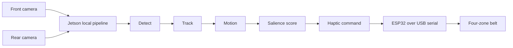

# Third Eye

Third Eye is an accessibility-focused physical-AI prototype for Knight Hacks IX. It gives a wearer **selective peripheral awareness**: two cameras observe nearby activity, a Jetson processes it locally, and a four-zone haptic belt signals the spatial events that matter most.

The goal is not to buzz for every object. Third Eye detects a person, follows that person over time, estimates whether their apparent size is growing or shrinking, scores relevance, and sends one clear directional cue only when it crosses an alert threshold.



## Current status

Milestone 1 is implemented: a software-only end-to-end path runs with deterministic mock front/rear cameras, person detections, simple per-camera tracking, smoothed motion classification, relevance scoring, priority selection, direction mapping, and mock haptic commands. The ESP32 firmware scaffold and a local dashboard scaffold are present.

This repository does **not** yet contain a verified Jetson CSI capture path, live YOLO inference, physical serial integration, or a finished dashboard feed. Those are the next hardware/integration milestones.

## How it works

Third Eye follows a deliberately small, explainable pipeline:

1. Two separately tagged camera streams supply front and rear frames; no panoramic stitching is used.
2. A detector emits structured detections. The first real target is `person`.
3. A simple IoU tracker assigns persistent per-camera track IDs.
4. Motion compares smoothed bounding-box area history: growing is `APPROACHING`, shrinking is `MOVING_AWAY`, and small changes are `STATIONARY`.
5. The salience layer scores class, approach, apparent closeness, centrality, motion magnitude, and persistence.
6. The highest relevant event is held briefly to avoid rapid switching, then becomes a `FRONT`, `RIGHT`, `REAR`, `LEFT`, or `STOP` command.
7. The command is sent through a transport abstraction. USB serial is the intended physical path; the default is a hardware-free mock transport.

All thresholds, weights, camera orientation behavior, model selection, and serial settings are centralized in [`config/default.json`](config/default.json). Copy it to ignored `config/local.json` for machine-specific settings.

## Confirmed prototype hardware

- NVIDIA Jetson Orin Nano Developer Kit
- Two Arducam 8MP IMX219 160° wide-angle cameras
- ESP32 development boards
- Four of the available 3V coin vibration motors for the MVP belt
- IRLZ44N MOSFETs for motor switching
- Wearable belt and power supplies

The Jetson and camera rig stay on the demo table. The wearer only needs the belt controller and haptic hardware.

## Local development

The mock path requires Python 3.10+ and no runtime third-party packages.

```bash
python3 -m venv .venv
source .venv/bin/activate
pip install -e .
PYTHONPATH=src python -m thirdeye.main --frames 30
```

It will log mock haptic decisions such as:

```text
[HAPTIC] zone=RIGHT intensity=82
```

Install only the optional adapters needed on that machine:

```bash
pip install -e ".[vision,dashboard,serial,dev]"
```

Then the lightweight local dashboard can be launched alongside a finite mock run:

```bash
PYTHONPATH=src python -m thirdeye.main --frames 300 --dashboard
# Open http://127.0.0.1:8000
```

The dashboard is intentionally a scaffold at this stage: it displays the live pipeline state JSON and the decision flow, rather than finalized video overlays.

### Rehearse decisions without hardware

Named mock scenarios make the demo-critical rules repeatable:

```bash
thirdeye --list-scenarios
thirdeye --scenario competing_people --frames 0
thirdeye --calibrate-orientation
```

See [software rehearsal](docs/software-rehearsal.md) for scenario expectations, dashboard replay, and camera-orientation calibration.

## Configure real adapters later

Keep `config/default.json` intact and create `config/local.json` with only local changes:

```json
{
  "cameras": {
    "front": {"source_type": "csi", "source": "<verified camera pipeline>"}
  },
  "detector": {
    "backend": "ultralytics",
    "model": "<local model path>"
  },
  "haptics": {
    "transport": "serial",
    "serial_port": "<ESP32 serial device>"
  }
}
```

Run it with `--local-config config/local.json`. The exact CSI pipeline and model choice should be verified on the Jetson before they are committed or documented as supported.

## ESP32 haptic controller

The initial firmware is in [`esp32/firmware/third_eye_haptics.ino`](esp32/firmware/third_eye_haptics.ino). It accepts `ZONE,INTENSITY` commands (for example `RIGHT,82`), controls MOSFET gates with PWM, and stops all motors after a communication timeout. See [`esp32/README.md`](esp32/README.md) and [`docs/hardware.md`](docs/hardware.md) before wiring or flashing it.

## Documentation

- [Architecture](docs/architecture.md)
- [Hardware plan and electrical safety](docs/hardware.md)
- [Jetson setup checklist](docs/jetson-setup.md)
- [Live demo plan](docs/demo-plan.md)
- [Judging strategy](docs/judging-strategy.md)
- [Software rehearsal](docs/software-rehearsal.md)

## Team roles

- Shade: Jetson software, perception, tracking, scoring, haptic protocol/transport, dashboard, and integration.
- Emma: belt construction, motor/MOSFET circuitry, ESP32 wiring, power, camera rig, and physical testing.

Both tracks meet at the explicit serial protocol and centralized configuration, so software and hardware can progress independently.

## Challenge alignment

- **NVIDIA Best Use of Jetson:** the Jetson is the central local perception engine for two live camera streams and low-latency decisions.
- **Best Embedded Hack:** ESP32-controlled, MOSFET-switched haptic outputs create a real wearable interface.
- **Best AI Hack:** local detection becomes tracking, motion interpretation, and explainable salience—not just bounding boxes.
- **Encompass Data Capturing Hardware:** camera data from the physical environment is transformed into immediate tactile feedback.
- **Hugging Face / open source AI:** an open-source model can be used locally if it materially improves the perception path; no superficial cloud dependency is planned.

## Roadmap

1. Verify one Arducam feed on the Jetson.
2. Run a lightweight pretrained local YOLO model against that feed and reliably detect people.
3. Add the rear camera, then validate the tracking → motion → salience → mock-haptics path.
4. Connect one ESP32/MOSFET/motor over serial, then expand to the four-zone belt.
5. Add video overlays and rehearse the live judge demo.

Working end to end is the priority over stretch features.
