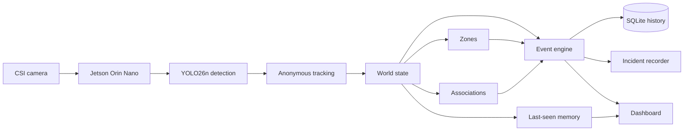

# ThirdEye

**Real-time, privacy-preserving edge AI for security and event understanding, running entirely on an NVIDIA Jetson Orin Nano.**

Most camera AI stops at "there is a person in frame 4,812." ThirdEye turns a live camera feed into *meaningful events*: who entered a restricted area, who has been lingering, which bag goes with which person, which bag was left behind, and who walked off with it. Every step runs locally on the Jetson. No cloud inference, and no continuous footage leaves the device.

## What it does

| Capability | What you see |
|---|---|
| Real-time detection | Ultralytics YOLO26n on the Jetson GPU, tuned for people and portable objects (backpack, handbag, suitcase) |
| Persistent anonymous tracking | Stable IDs (`Person #3`, `Bag #7`) that survive brief occlusions. No faces, no names |
| Restricted-zone monitoring | Zone entry / exit events for a configurable restricted area |
| Dwelling detection | Alert when someone stays in a zone for more than 10 s |
| Occupancy and crowding | Live occupancy count, crowding start and clear events |
| Portable-object tracking | Bags tracked as their own entities with a stable class label |
| Person-object association | Links a bag to the person it stays close to over time (association, not a claim of ownership) |
| Unattended objects | Alert when a bag is separated from its associated person for more than 5 s |
| Object moved / left with person | Detects a bag being moved, or leaving view together with a person |
| Last-seen memory | Every entity is remembered after it leaves view: when and where it was last seen, and who it was with |
| Last-seen snapshots | A small crop of each portable object is saved for the memory panel |
| SQLite event history | Every event and entity summary is persisted locally and can be queried from the CLI |
| Incident recording | Event-triggered clips from 5 s **before** to 12 s **after** a meaningful event, linked to the triggering events in SQLite |
| Dashboard | A clean judge-facing view, plus a debug view with performance counters, the tracker table, association states and the raw event log |

## Privacy at the edge

- **Local processing.** Capture, inference, tracking, events, storage and recording all run on the Jetson. The core demo needs no network connection or cloud service.
- **Anonymous identities.** Tracking IDs are session-local numbers. There is no face recognition and no biometric identity.
- **Event-triggered recording.** Instead of recording everything, ThirdEye keeps a short rolling buffer in memory and only writes a clip to disk when something meaningful happens. Everything else is discarded.

## Architecture



```
Camera -> Jetson -> YOLO -> tracking -> world state
       -> zones / associations / event engine
       -> SQLite / incident recorder -> dashboard
```

- Capture and YOLO inference run on a worker thread, so inference of frame N+1 overlaps event processing and rendering of frame N.
- Each pipeline stage is isolated. If one stage throws, it is logged and skipped for that frame, and the video keeps running.
- The incident recorder JPEG-encodes about 10 frames per second into a bounded in-memory buffer on its own thread, and writes H.264 clips on a separate writer thread. It never blocks the camera loop.

Key code:

| Path | Role |
|---|---|
| `third_eye_app.py` | Live application: camera, pipeline, dashboard, CLI flags |
| `run_demo.sh` | Demo launcher: environment, display detection, pre-flight diagnostics |
| `src/thirdeye/core/settings.py` | All tunables in one place (camera, thresholds, zones, timers) |
| `src/thirdeye/tracking/` | Anonymous multi-object tracking |
| `src/thirdeye/state/` | World state and last-seen entity memory |
| `src/thirdeye/spatial/zone_manager.py` | Zones and entry / exit |
| `src/thirdeye/relationships/` | Person-object association |
| `src/thirdeye/events/` | Event engine (dwelling, crowding, unattended objects, ...) |
| `src/thirdeye/storage/event_store.py` | SQLite event, entity and incident history |
| `src/thirdeye/recording/` | Rolling buffer and incident clip recorder |
| `src/thirdeye/ui/` | Demo dashboard and debug view |

## Hardware and software

- NVIDIA Jetson Orin Nano
- CSI IMX219 camera, captured at 1280×720 through `nvarguscamerasrc`
- JetPack 7.2.1 (CUDA, PyTorch with CUDA)
- OpenCV with GStreamer (the JetPack system build)
- Ultralytics YOLO26n (`yolo26n.pt`, 640 px input)
- Python 3.12

On the Orin Nano the full pipeline with the dashboard runs at about 20 FPS. Turning on incident recording made no measurable FPS difference in live benchmarks.

## Running the demo

On the demo Jetson, the environment is already set up. From the repository root:

```bash
# Normal stable mode
./run_demo.sh --fullscreen

# Judge demo with incident recording
./run_demo.sh --fullscreen --incidents

# Start in the debug view
./run_demo.sh --debug
```

`run_demo.sh` activates `.venv`, sets `PYTHONPATH`, finds the local display and runs quick pre-flight diagnostics (OpenCV/GStreamer, CUDA/GPU, model file, pipeline modules, SQLite) before launching. Set `THIRDEYE_SKIP_DIAG=1` to skip the diagnostics.

**Keys:** `Q` quit · `F` toggle fullscreen · `D` switch between demo and debug views · `1`–`4` open a recently seen object · `0` / `X` close it.

**Useful options** (all passed through `run_demo.sh`):

| Option | Effect |
|---|---|
| `--incidents` | Save event-triggered incident clips (off by default) |
| `--zone x1,y1,x2,y2` | Override the restricted zone, as fractions of the frame (for example `0.6,0.1,0.95,0.9`) |
| `--record out.mp4` | Record the dashboard |
| `--record-raw raw.mp4` | Record raw camera frames plus timestamps, for replay |
| `--source clip.mp4` | Replay a recorded video instead of the live camera |
| `--headless --seconds 30` | Run without a window, for example over SSH |
| `--no-store` | Do not write events to SQLite |

**Where the output goes** (all of `data/` is git-ignored):

| Output | Location |
|---|---|
| Event, entity and incident history | `data/events.sqlite3` |
| Incident clips | `data/incidents/<session>/inc-<time>-<n>_<event>.mp4` |
| Last-seen snapshots | `data/snapshots/` |

When incident recording is on, the app prints a list of the clips it saved when it exits. To inspect the history afterwards:

```bash
PYTHONPATH=src .venv/bin/python -m thirdeye.storage.event_store --recent 20
PYTHONPATH=src .venv/bin/python -m thirdeye.storage.event_store --incidents
```

### Setting up a new Jetson

The project venv must see the JetPack system OpenCV (built with GStreamer), so create it with system site packages. Then install a CUDA-enabled PyTorch build that matches your JetPack, plus Ultralytics. Place `yolo26n.pt` in the repository root.

```bash
python3 -m venv --system-site-packages .venv
# install the JetPack-matched CUDA PyTorch, then:
.venv/bin/pip install ultralytics pytest
```

### Tests

```bash
PYTHONPATH=src .venv/bin/python -m pytest -q
```

The tests cover tracking, zones, events, associations, memory, storage, the incident recorder, the app's `--incidents` integration and `run_demo.sh` argument passing. They need no camera or GPU.

## Demo scenario

1. **A person walks into view.** They get an anonymous ID and the occupancy count goes up.
2. **They carry a bag.** After a few seconds of proximity the bag is *associated* with that person.
3. **They step into the restricted zone and stay.** A zone-entry event fires, then a dwelling alert after 10 s. With `--incidents`, a clip is saved covering the 5 s before entry through the dwell.
4. **They put the bag down and walk away.** The bag is flagged as an **unattended object**.
5. **Someone else picks it up.** ThirdEye reports the bag as **moved**, or as having **left view with** that other person.
6. **Afterwards**, the bag is still in last-seen memory: press `1`–`4` to see where and when it was last seen, who it was with, and its snapshot.
7. Every step is in the SQLite event history. Every meaningful alert has an incident clip that starts *before* the event, so you see what led up to it.

Events that trigger incident clips: restricted-zone entry, dwelling, crowding, unattended object, object moved, and object left view with a person. A trigger that arrives while a clip is recording extends that clip, up to 30 s.

## Current limitations

- **Single camera, demo-scale scenes.** Thresholds are tuned for one camera and a handful of people and bags.
- **Portable-object detection depends on conditions.** Bags are smaller and less distinctive than people. Lighting, angle and distance affect how reliably they are detected.
- **Anonymous IDs are not permanent.** An ID can reset after a long occlusion or a long time out of view. Last-seen memory keeps the history, but a returning person may get a new number.
- **The restricted zone is a fixed rectangle**, set in `settings.py` or with `--zone`.
- **Incident clips are 1280×720 at 10 fps.** They are evidence clips, not full-frame-rate video. The dashboard does not show a "clip saved" indicator. Clips are listed in the terminal on exit and in SQLite.
- **Object re-identification is experimental** and is not part of the production demo or the production build.

## Project status

- ✅ Core live demo working on the Jetson: detection, tracking, zones, events, associations, memory, history and dashboard
- ✅ Incident recording validated live with no measurable FPS cost, and available with `--incidents`
- 🧪 Object re-ID remains experimental and off by default

## Project evolution

ThirdEye started at Knight Hacks IX as a wearable accessibility prototype: cameras and a Jetson driving a haptic belt. The perception work from that phase grew into the current edge event-intelligence platform. Some modules from that phase are still in the repository but are not used by the live app: `src/thirdeye/main.py`, `haptics/`, `salience/`, `esp32/`, and the original planning notes in `docs/`.
