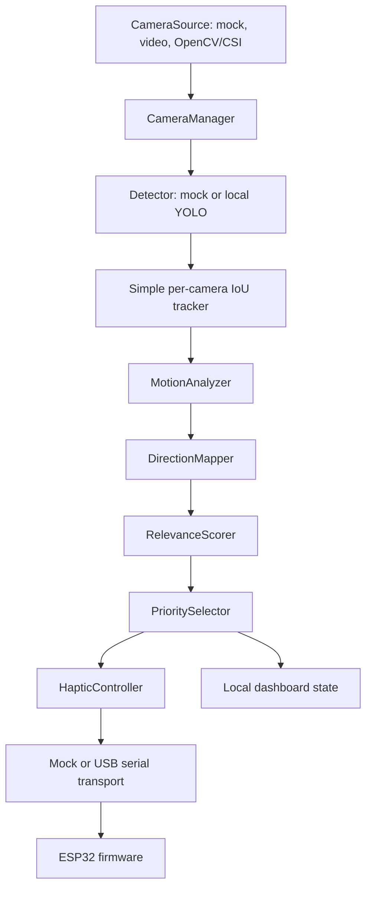

# Architecture

Third Eye separates hardware-specific adapters from the demo-critical decision logic. This lets the mock pipeline run while the Jetson, cameras, belt, and ESP32 are assembled independently.

## Contracts

- `FramePacket` always contains `source_camera`, timestamp, dimensions, and an adapter-owned payload.
- `Detection` carries class, confidence, bounding box, normalized center, source camera, and an optional object ID.
- `Track` owns the stable ID, bounded observation history, and current motion state.
- `ScoredEvent` pairs a track with a mapped belt zone and a 0.0–1.0 relevance score.
- `HapticCommand` is one validated `ZONE,INTENSITY` action. `STOP` always has intensity 0.

## Direction calibration

The direction mapper uses the tagged source camera plus normalized horizontal position. Front center maps to `FRONT`; rear center maps to `REAR`. Left/right mappings are configurable independently for each camera because mounting orientation must be verified physically. Mirroring is also configured per source.

## Salience model

The current score is a clamped weighted sum of:

- class relevance
- approaching state
- apparent closeness from normalized bounding-box area
- horizontal centrality
- recent apparent-size change
- persistence across frames

This is intentionally heuristic rather than learned: it can be explained to judges and tuned during rehearsal. The selector ignores events below the alert threshold and holds the active object briefly unless a challenger is materially more relevant.

## Adapter boundaries

OpenCV, Ultralytics, FastAPI, Uvicorn, and pyserial are optional. The default code path imports none of them. TensorRT is not required or referenced by the runtime path. When Jetson optimization becomes necessary, it should be implemented as another detector adapter with the same `Detector` contract.

## Rehearsal mode

`simulation/scenarios.py` provides named, finite timelines of normalized mock objects. They use the same `MockCameraSource` and `MockDetector` contracts as the ordinary software-only path, then run through tracking, motion, salience, direction, selection, haptics, and dashboard state. This is a regression harness, not a substitute for live camera validation.
